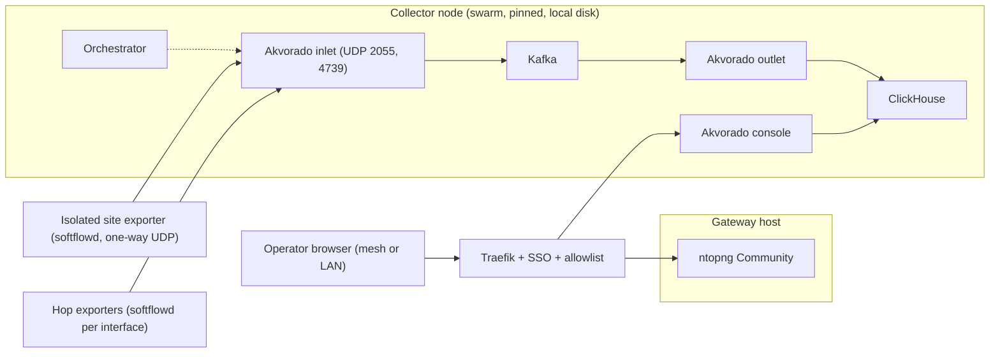

# sknet-skworld-io

The static landing page for [sknet.skworld.io](https://sknet.skworld.io), served via GitHub Pages
directly from this repository's `index.html` and `CNAME`.

sknet is an skstacks service for network flow visibility across mesh hops: softflowd exporters on each
hop send NetFlow v9 to one collector, where Akvorado keeps an estate-wide flow history and ntopng
Community gives a live view. Both web UIs sit behind SSO and a mesh or LAN allowlist, and isolated
sites get one one-way telemetry exception. See the
[smilinTux/skstacks](https://github.com/smilinTux/skstacks) repository (the optional `sknet` role) for the
implementation this site is grounded in.

Built on [Akvorado](https://github.com/akvorado/akvorado) (AGPL-3.0) and
[ntopng Community](https://www.ntop.org/products/traffic-analysis/ntop/) (GPLv3). Upstream UIs and
logos are kept; sknet only automates deploying and gating them.

## Component map

The interactive version, with motion and a dark/light toggle, is published at
[diagrams/sknet.architecture.html](diagrams/sknet.architecture.html) and linked from the live
site's [Architecture section](https://sknet.skworld.io/#architecture). Two further diagrams cover
the data flow and the rollout order, both under [diagrams/](diagrams/).

## Diagrams

All three diagrams are authored as [Archify](https://github.com/tt-a1i/archify) JSON and built to
standalone, self-contained HTML. The `archify` workflow regenerates the HTML from the JSON.

| Diagram | JSON source | Built HTML |
|---|---|---|
| Component map (architecture) | `diagrams/sknet.architecture.json` | `diagrams/sknet.architecture.html` |
| Data flow (traffic to flows to console) | `diagrams/sknet.dataflow.json` | `diagrams/sknet.dataflow.html` |
| Rollout order (collector, exporters, live view) | `diagrams/sknet.workflow.json` | `diagrams/sknet.workflow.html` |

## Docs viewer

`docs.html` renders `smilinTux/skstacks` at `v1/ansible/optional/sknet/docs/*.md` live from the
GitHub Contents API, with `docs-manifest.json` as a committed offline fallback and a daily
self-healing GitHub Action (`.github/workflows/refresh-docs-manifest.yml`) to keep it in sync.

This site is part of the [SKWorld](https://skworld.io) sovereign AI ecosystem. Related:
[SKStacks](https://skstacks.skworld.io), [sksec](https://sksec.skworld.io),
[skpatch](https://skpatch.skworld.io).

## License

MIT License, see [LICENSE](./LICENSE). Akvorado and ntopng Community keep their own licenses.
